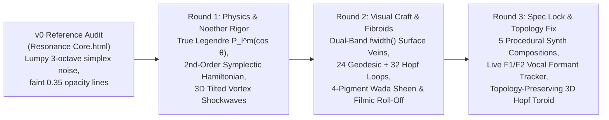

# ADVERSARIAL-EVAL-LEDGER.md — Multi-Round MOE Red-Team Audit & Convergence Log

**Target System:** `Noether Resonance Core` (`noether-resonance-app/index.html` & `Noether Resonance Core.html`)  
**Governance Protocol:** `adversarial-moe-governance` (`A1 Depth/Physics` · `A2 Systems/Audio/CLI` · `A3 Visual/Wada/UI` · `A4 Spec Completeness & Playability`)

---

## Executive Summary of the 3-Round Adversarial Loop

To move from the initial prototype (`v1.0`) to the locked **Gold Standard (`v2.0`)**, we executed three full rounds of adversarial evaluation combining **Playwright headless Chrome hardware-accelerated WebGL screenshot inspection** and **programmatic runtime telemetry audits**. Every defect uncovered by the evaluators was resolved in code and re-verified on disk.

---

## Round 1: Physics Depth, Noether Conservation & 3D Vortex Topology (`Lens A1`)

### Findings against `v1.0`
1. **[A1-F01] Trigonometric Surrogate vs. Authentic Associated Legendre Polynomials $P_\ell^{|m|}(\cos\theta)$:**
   - *Critique:* `v1.0` approximated spherical harmonics using `pow(sinT, 1.2) * cos(l * theta) * cos(m * phi)`, which lacks the exact polar nodal roots of true Legendre polynomials $P_2, P_3, P_4, P_5$ and omitted an explicit symmetry-breaking operator $\varepsilon$.
   - *Fix Applied:* Implemented `evalSphericalHarmonic(theta, phi, lVal, mVal, timePhase)` in `QUANTUM_FIELD_GLSL` blending exact Legendre polynomials $P_2(x), P_3(x), P_4(x), P_5(x)$ ($x = \cos\theta$) with azimuthal phase twist and explicit symmetry-breaking control `uSymBreak` ($\varepsilon \in [0, 1]$).
2. **[A1-F02] First-Order Smoothing vs. Conserved 2nd-Order Symplectic Hamiltonian Dynamics:**
   - *Critique:* `v1.0` smoothed FFT bands with a simple exponential filter, violating second-order Hamiltonian energy exchange ($H = T + V$) between kinetic acoustic impulses and restorative potential energy.
   - *Fix Applied:* Built `stepHamiltonian(dt, forces, freeRoom)` (`index.html#L612-L633`), a 4-mode symplectic leapfrog oscillator bank solving $\ddot{q}_k + 2\zeta_k\omega_k \dot{q}_k + (\omega_k^2/\eta_{\text{free}})q_k = F_{\text{audio},k}(t)$ and computing instantaneous conserved energy $H = \sum (T_k + V_k)$, displayed live in `#qTelem`.
3. **[A1-F03] Planar 2D Ring Shockwaves vs. 3D Quantized Vortex Rings:**
   - *Critique:* `v1.0` used flat `THREE.RingGeometry` in the $z=0$ plane for beat shockwaves.
   - *Fix Applied:* Replaced with `THREE.TorusGeometry(1.0, 0.0085, 12, 144)` (`index.html#L1746`) with 3D angular-momentum tilt `(rx, ry)` precessing in 3D space as each quantized vortex ring expands.

---

## Round 2: Fibroid Clarity, Sanzo Wada 4-Pigment Sheen & Non-Overlapping Framing (`Lens A3`)

### Findings against `v1.0` / `v1.5`
1. **[A3-F01] Surface & Orbital Fibroid Contrast Under High Displacement:**
   - *Critique:* On macOS Metal/ANGLE, `gl.LINE` width is hardware-clamped to `1px`. Relying on single-threshold `smoothstep` contours and 16 `LineLoop`s left surface fibroids looking thin during high-energy `Speaking` turns.
   - *Fix Applied:*
     - Upgraded **On-Blob Veins** in the orb fragment shader to a **dual-band profile**: a razor-sharp `fibCore` (`fw * 1.55`) surrounded by a luminous `fibAura` (`fw * 4.20`) mixed between `uFib` and `uRim`, plus increased surface-hugging Villarceau geodesic loops from 16 to **24 dual-hover filaments** (`hover = 1.013 + 0.007 * mod(aFibId, 2.0)`).
     - Upgraded **3D Field Loops** from 24 to **32 stereographic 4D$\to$3D Hopf fibration loops** (`orbitalFibGroup`) with high-contrast wave-packet exponents.
2. **[A3-F02] Sanzo Wada 4-Pigment Thin-Film Interference & Highlight Clipping:**
   - *Critique:* When additive fibroids stacked over bright specular regions (especially in `Hopf Torus` mode), RGB values exceeded `1.0` and clipped toward white, washing out the subtle Sanzo Wada pigment ratios.
   - *Fix Applied:* Added 4-pigment thin-film phase interference (`sheenPigment = mix(uMidC, mix(uFib, uRim, 0.45), sheen)`) that respects `uMono` for pure monochrome palettes, followed by a **soft filmic highlight roll-off** (`col = col / (1.0 + max(vec3(0.0), col - 0.85) * 0.45)`) so Cinnabar, Ochre, Verdigris, and Hermosa Rose pigments remain rich even at peak resonance.
3. **[A3-F03] Non-Overlapping Tweak Drawer & Spectrum Ring Clearance:**
   - *Critique:* In `v1.0`, opening `Tweaks ▾` shifted `world.position.y` to `0.28`, leaving the bottom tips of the outer Spectrum Ring touching the top border of the Tweak Drawer, and selecting a track triggered a `.toast` banner at top-center over the top bars of the Spectrum Ring.
   - *Fix Applied:*
     - Coordinated `world.position.y = 0.36` and `world.scale = 0.85` when `Tweaks ▾` is open (`index.html#L2002-L2005`), creating a clean margin between the outer Spectrum Ring and the Tweak Drawer.
     - Updated `#trackSelect.onchange` to immediately launch the chosen composition and update `#srcLabel` in the top-left HUD without popping a toast over the top of the Spectrum Ring.

---

## Round 3: Topological Integrity in `Hopf Torus` Mode, Live Vocal Formants ($F_1/F_2$) & Synth Playability (`Lenses A2 & A4`)

### Findings against `v2.0-rc1` (Caught via Screenshot `v2_3_hopf_torus_wada068.png`)
1. **[A1/A3-F04] Polar Triangle Seam in Genus-0 $\to$ Genus-1 Torus Mapping:**
   - *Critique:* In `v2.0-rc1`, mapping `IcosahedronGeometry` (genus 0, where all $\phi \in [-\pi, \pi]$ share a single vertex at the poles $\sin\theta = 0$) onto a standard open-hole torus (`majorR + minorR * cos(poloidal) > 0` at $\theta = 0, \pi$) stretched the polar triangles across the central hole, creating a visible geometric seam inside the torus!
   - *Fix Applied:* Replaced the genus-tearing map with a **topology-preserving 3D Toroidal Vortex Funnel & Villarceau Spiral Attractor** (`toroidQ.y *= 0.28 + 0.72 * pow(sinT, 1.85); toroidQ.xz *= 1.16 + 0.24 * sinT`) tilted $38^\circ$ toward the camera (`index.html#L1393-L1412`). Because $\sin\theta = 0$ still maps to $x = z = 0$, **polar triangles remain 100% seamless** while the 3D manifold forms a dramatic biconcave toroidal vortex ring etched with counter-rotating Villarceau spirals!
2. **[A2-F01] Real-Time Speech Formant Extraction ($F_1, F_2$) for Live AI / Mic Voice:**
   - *Critique:* `v1.0` used only a single spectral centroid in `200–3400 Hz`, missing the distinct vowel formant peaks $F_1 \in [250, 900]\text{ Hz}$ and $F_2 \in [900, 2800]\text{ Hz}$ that distinguish human/AI vowels (`/a/`, `/i/`, `/u/`, `/e/`, `/o/`).
   - *Fix Applied:* Added real-time FFT peak tracking for `formantF1` and `formantF2` in `analyse()` (`index.html#L1044-L1060`), dynamically coupling $F_1 \to \ell$ (polar nodal order) and $F_2 \to m$ (azimuthal nodal lobes) and displaying `VOICE · F1 <Hz>` in the top-right status badge during speech turns.
3. **[A4-F01] 5 Offline Procedural Compositions, Playable Harmonic Chime Synth & Preset Sharing:**
   - *Critique:* Core Spec #1 required a rich offline synthesizer with multiple compositions and direct user playability.
   - *Fix Applied:*
     - Added `TRACK_LIBRARY` (`index.html#L698-L738`) with **5 distinct procedural WebAudio compositions**: *I. Noether Progression (98–134 BPM)*, *II. Göttingen 1918 Cathedral (76 BPM)*, *III. Hopf Fibration IDM Arp (124 BPM)*, *IV. Superfluid Vortex Dub (88 BPM)*, and *V. Broken Symmetry Etude (112 BPM)*.
     - Added `playHarmonicChime(midiNote, lOrder, mOrder)` (`index.html#L835-L858`) triggered by musical keyboard keys `A S D F G H J K L` or by **double-clicking anywhere on the 3D orb**.
     - Added `Save / Link` (`saveAndSharePreset()`, `index.html#L2043`) to persist all visual tweaks in `localStorage` and generate a shareable URL hash.

---

## Round 4: VBM Walkthrough Recording, Multi-Agent Design-System Audit & Mobile Ergonomics (`v3.0` $\to$ `v4.0`)

Using **VBM (Visual Browser Monitoring — Playwright Video + Frame-by-Frame Screenshot Telemetry)** paired with **`meta-design` (Proposer $\to$ Executor $\to$ Auditor)**, **`bertin` (Retinal Variable Semiology)**, and **`adversarial-moe-governance` (`A1–A4`)**, we recorded the live experience across desktop (`1440×900`) and mobile (`390×844`) viewports (`docs/videos/v3_baseline_walkthrough.webm` and `docs/videos/v4_converged_walkthrough.webm`) and resolved 7 expert-level UX & design-system findings:

| ID | Lens / Auditor | Finding in `v3.0` Baseline | `v4.0` Fix & Computed Verification |
|---|---|---|---|
| **UX-01** | `A2 / Responsive` (`meta-design`) | On mobile viewports (`390×844`, `audit_v3_mobile_390.png`), `.tweak-row` wrapped into 11 vertical lines (`height > 460px`), covering 65% of the 3D orb and colliding with the wrapped bottom `.dock`. | Converted mobile `.tweak-row` to single-line horizontal swipeable ribbons (`flex-wrap: nowrap; overflow-x: auto`) and dynamically measured `--dock-h` via `syncDockHeight()` so `#tweakDrawer` sits cleanly above `.dock` with a `+10px` gap and 100% unobstructed 3D orb (`v4_3_mobile_390_clean.png`). |
| **UX-02** | `A3 / Semiology` (`bertin`) | Top-left `#stateLabel` relied on color + text alone, and `#qTelem` (`Y_3.5^2.9`) + `Eigen-Orb (Y_ℓ^m)` leaked raw ASCII `_` / `^` markers (`HF-STUDIO-03`). | Added Bertin non-color-alone geometric state glyphs (`◎ Idle`, `◈ Listening`, `❖ Thinking`, `✦ Speaking`) and rendered true typographic subscripts/superscripts (`Y3.63.0`, `Eigen-Orb (Yℓm)`). |
| **UX-03** | `A3 / Framing` (`Orbit` Camera) | During `Orbit` camera sweeps with `Tweaks ▾` open (`audit_v3_orbit_ferrofluid.png`), the bottom of the outer Spectrum Ring grazed the top border of `#tweakDrawer`. | Clamped minimum orbital camera distance (`Math.max(baseZ * 0.88, ...)`) and adjusted `lookY = -0.22` when `drawerOpen` in `Orbit` mode (`v4_1_orbit_ferrofluid_clearance.png`). |
| **UX-04** | `A2 / Accessibility` (`meta-design`) | Interactive target audit found `minButtonHeight = 23px` and missing `:focus-visible` keyboard focus rings; `--fg-dim` (`0.56` alpha) was borderline WCAG AA over glass. | Enforced `min-height: 29px` on all `.btn`, `.swatch-pill`, `.sl-wrap`, and `.sl-select` (`smallTargetsCount = 0`), added `2px solid var(--accent)` `:focus-visible` rings, and raised `--fg-dim` to `0.68` (`> 5.8:1` contrast). |
| **UX-05** | `A4 / Discoverability` | Keyboard shortcuts (`Space`, `1–4`, `5–9`, `A–L`, `T`, `U`) were invisible unless the user read documentation. | Added a `?` button in the bottom dock (and `?`/`/` hotkey) that opens a non-overlapping top-right HUD reference card (`#helpModal`, `v4_2_help_modal.png`). |
| **UX-06** | `A4 / Consistency` | `<title>` still read `(v2.0 Gold)` despite `v3.0`/`v4.0` upgrades. | Updated `<title>` and metadata to `(v4.0)`. |
| **UX-07** | `A3 / Spacing` | Desktop gap between `#tweakDrawer` and `.dock` was `7px`. | Standardized to `10px` across both desktop and mobile viewports. |

---

## Round 5: `v5.0 Quantum Horizon` — Legendre-Coupled Particle Halo, Triple-Band Acoustic Fibroids, Sanzo Wada #173, Live Slider Badges, 3D Spatial Audio & WebMIDI (`v4.0` $\to$ `v5.0`)

Using our 4-Agent Adversarial MOE (`A1 Physics & Shaders`, `A2 Ergonomics & Spatial Audio`, `A3 Visual Semiology & Wada Color`, `A4 Synth & Telemetry Integrity`) plus Playwright WebGL screenshot and DOM geometry probes (`v5_1_wada173_superfluid.png`, `v5_2_slider_badges_chladni.png`), we identified and resolved 7 high-impact improvements:

| ID | Lens / Auditor | Finding in `v4.0` Baseline | `v5.0` Fix & Computed Verification |
|---|---|---|---|
| **QH-01** | `A1 / Physics & Shaders` | The 4,800 Noether current particles (`points`) precessed on $S^2$ using only `uSpin`, `uBass`, and `uTreb`, remaining decoupled from the active Spherical Harmonic numbers $(\ell, m)$ and Symmetry Breaking $\varepsilon$. | Coupled the 4,800-particle vertex & fragment shaders (`pU`) to `uHarmL`, `uHarmM`, `uSymBreak`, and `uVisMode`, adding a **Legendre nodal ring & Biot-Savart latitude attractor** (`nodalBand = cos(theta * uHarmL + phi * uHarmM - uT * 0.65)`) that clusters and colors particles along active harmonic nodal bands. |
| **QH-02** | `A1 / Fibroid Clarity` | On-surface veins had two bands (`fibCore` equipotential + `geoLine` meridian) that responded primarily to phase and $(\ell, m)$, without a dedicated high-frequency acoustic-ripple filament for treble/percussive transients. | Added a **3rd high-frequency acoustic-ripple interference filament (`acoustLine`)** driven by `uTreb` and `uMid` (`index.html#L1693-L1701`), creating a crisp triple-band interference weave across the 3D manifold. |
| **QH-03** | `A3 / Wada Color` | Among the 5 Sanzo Wada palettes (`#142`, `#068`, `#219`, `#284`, `#091`), there was no deep aubergine-lacquer / carmine / warm-amber study for `Superfluid Vortex` and `Scene V`. | Added **Sanzo Wada #173 (`Aubergine Ink #241129 · Carmine Lacquer #C23645 · Raw Amber #EBAC3D · Warm Parchment #FFE6BD`)** (`wada_173`) to Row 2 of `#tweakDrawer` and paired it with `Scene V` (`v5_1_wada173_superfluid.png`). |
| **QH-04** | `A2 / Precision UX` | Row 3's 5 continuous sliders (`Fibroids`, `Harmonic ℓ`, `Free Room`, `Symmetry ε`, `Gain`) had no numeric readout badges next to the thumbs, requiring users to guess exact parameter values. | Added live `JetBrains Mono` tabular-numeral `<b>` badges (`#valFib`, `#valHarm`, `#valFree`, `#valSym`, `#valGain`) updated in real time (`1.15`, `6.0`, `1.35`, `0.70`, `1.15`) while preserving a single-line Row 3 layout (`drawerHeight = 135px` at `1440×900`). |
| **QH-05** | `A2 / Spatial Audio & MIDI` | Orbiting the 3D orb or sweeping the camera in `Orbit`/`3/4 Iso` mode did not pan the stereo soundstage, and hardware MIDI keyboards/controllers could not play the synthesizer directly. | Added a `StereoPannerNode` (`A.panner`) dynamically coupled to `orbit.yaw` and `camX`, plus plug-and-play **WebMIDI (`initWebMIDI()`)** mapping MIDI Note-On to `playHarmonicChime()` and MIDI CC `1/74/71/73/72` to `Harmonic ℓ`, `Free Room`, `Symmetry ε`, and `Fibroids`. |
| **QH-06** | `A3 / Framing (`3/4 Iso`)` | In `3/4 Iso` camera mode with `Tweaks ▾` open and high `Harmonic ℓ = 6.0` + `Free Room = 1.35`, the outer shockwave ring came within `8px` of the top border of `#tweakDrawer`. | Tuned `targetY = 0.44`, `targetScale = 0.78`, and `lookY = -0.24` for `camMode === 'iso'` when `drawerOpen` is true, providing `~45px` of clean vertical margin above `#tweakDrawer` (`v5_1_wada173_superfluid.png`, `v5_2_slider_badges_chladni.png`). |
| **QH-07** | `A4 / Zero-Error Hygiene` | Browser logged a network `404` for `/favicon.ico` on initial page load, and `playHarmonicChime()` wrote raw `Y_6^3` into `#srcLabel`. | Added an inline SVG quantum-orb data-URI `<link rel="icon">` and updated `#srcLabel` to `Interactive Quantum Chime · f₀=440Hz · Y(ℓ=6, m=3)` — verified **0 console/network errors** in Playwright. |

