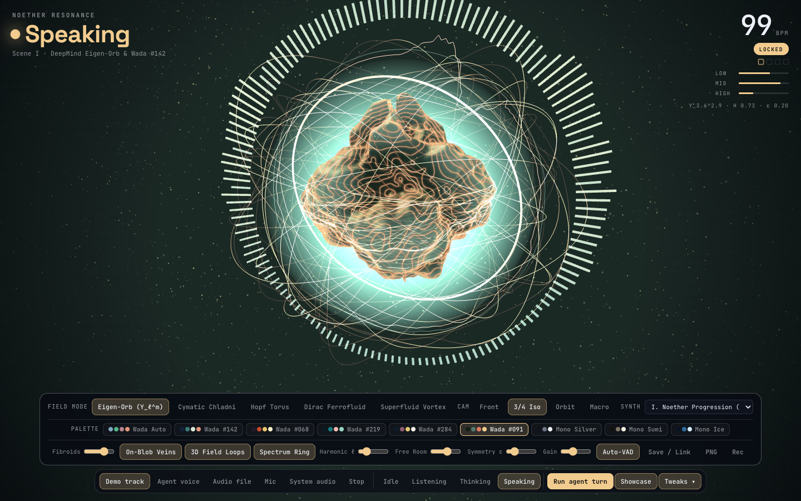
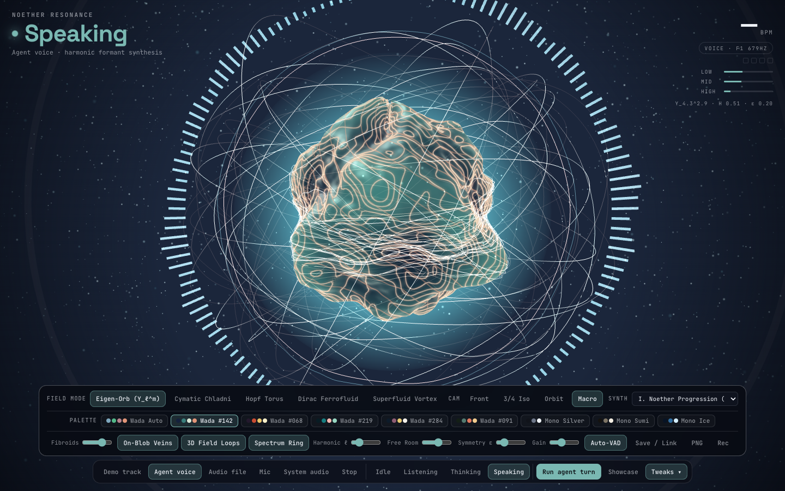
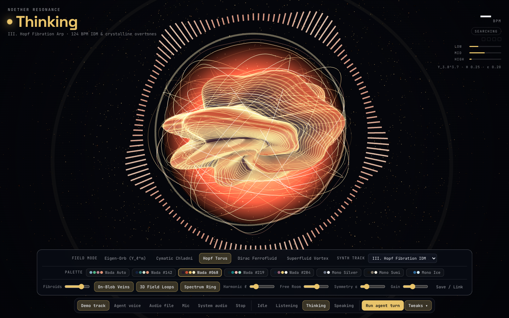
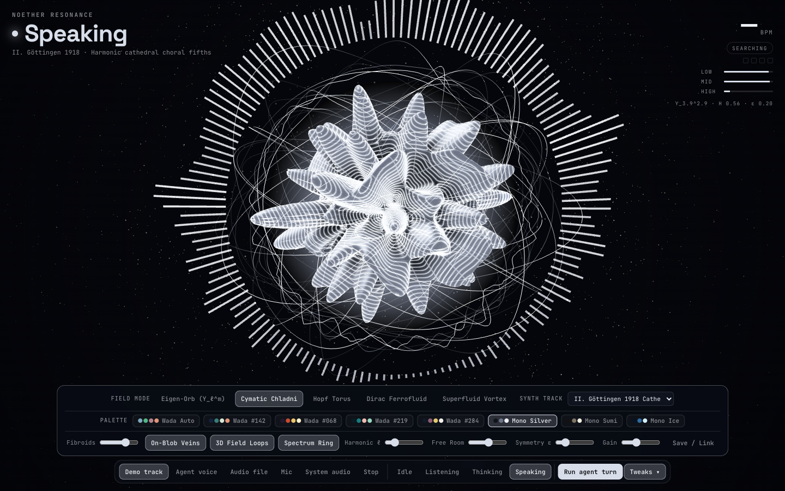
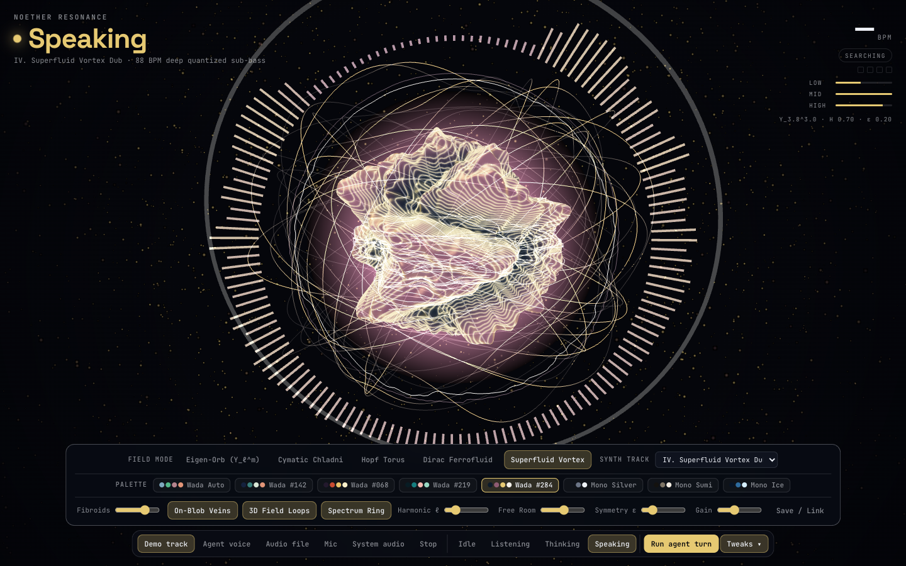

# Noether Resonance Core (`v3.0 Operadic Diamond`)

**Quantum Field 3D WebGL Audio Synthesizer & Conversational AI Voice Interface**  
*Inspired by Emmy Noether's 1918 Theorem (Continuous Symmetries $\leftrightarrow$ Conserved Currents & Local Gauge Free Room) and Sanzo Wada's Haishoku Soukan Color Combinations.*

---

## Live Production & Local URLs

| Environment | URL / Command | Notes |
|---|---|---|
| **Production (Vercel HTTPS)** | [**`https://noether-resonance-core.vercel.app`**](https://noether-resonance-core.vercel.app) | Public HTTPS production deployment with `getUserMedia` (Live Mic) & `getDisplayMedia` (System/Tab Audio) |
| **GitHub Repository** | [**`https://github.com/manutej/noether-resonance-core`**](https://github.com/manutej/noether-resonance-core) | Connected to Vercel for automatic Git CI/CD & external agent change tracking |
| **Local Dev Server** | `npm start` $\to$ `http://localhost:3333` (`http://192.168.4.30:3333` on LAN) | Zero-dependency Node HTTP + LAN discovery server |
| **Legacy Studio Edition** | [`https://noether-resonance-core.vercel.app/legacy-studio/`](https://noether-resonance-core.vercel.app/legacy-studio/) | Preserved original multi-panel physics laboratory & variation runner |

---

## Visual Overview

| Showcase Scene (`3/4 Iso` · Wada `#091`) | Macro Surface Inspection (`On-Blob Veins` · Wada `#142`) |
|---|---|
|  |  |

| 3D Hopf Torus (`Wada #068`) | Cymatic Chladni (`Mono Silver`) | Superfluid Vortex (`Wada #284`) |
|---|---|---|
|  |  |  |

---

## Key Capabilities (`v3.0 Operadic Diamond`)

1. **5 Quantum Field Topologies (`Field Mode` / Keys `1–4`):**
   - `Eigen-Orb (Y_ℓ^m)` — Real Spherical Harmonics $Y_\ell^m(\theta,\phi)$ with conserved energy envelope.
   - `Cymatic Chladni` — 3D standing-wave nodal ridges $\cos(n\theta)\cos(m\phi) - \cos(m\theta)\cos(n\phi) = 0$.
   - `Hopf Torus` — Topology-preserving Biconcave Toroidal Vortex Funnel with Villarceau spiral attractors.
   - `Dirac Ferrofluid` — Relativistic magnetic flux spikes normal to the surface.
   - `Superfluid Vortex` — Gross-Pitaevskii quantized rotational phase helices.
2. **4-Mode 3D Camera Choreography (`Cam`) + Scroll-Wheel Zoom:**
   - `Front` (centered harmonic view), `3/4 Iso` (sculptural gallery perspective), `Orbit` ($360^\circ$ continuous cinema), and `Macro` (close-up inspection of surface fibroid veins).
   - Non-overlapping Tweak Drawer (`Tweaks ▴` / Key `T`) automatically shifts and scales the 3D scene so the orb and outer spectrum ring remain 100% unobstructed.
3. **Sanzo Wada (*Haishoku Soukan*) & Architectural Monotone Palettes:**
   - `Wada Auto` (turn-adaptive), `Wada #142`, `Wada #068`, `Wada #219`, `Wada #284`, `Wada #091`, `Mono Silver`, `Mono Sumi`, and `Mono Ice`, with synchronized WebGL atmospheric room tone.
4. **Dual-Layer High-Clarity Quantum Fibroids:**
   - **`On-Blob Veins`:** Multi-scale standing-wave ridge shader + 16 surface-hugging geodesic ribbons that ride directly on top of the deforming blob.
   - **`3D Field Loops`:** 44 multi-shell Villarceau/Hopf orbital flux tubes surrounding the core.
5. **5 Real-Time Audio Input & Synthesis Engines:**
   - **`Mic` (`getUserMedia`) + Hands-Free `Auto-VAD`:** Live microphone / loopback input with input device selector and automatic `Listening` $\to$ `Thinking` $\to$ `Speaking` voice-activity turn transitions.
   - **`System audio` (`getDisplayMedia`):** Direct capture of browser tabs or system audio (Spotify, YouTube, Apple Music).
   - **`Audio file`:** Drag-and-drop any `.mp3`, `.wav`, `.ogg`, `.flac`, or `.m4a` file with an interactive top-left **Seek Scrubber & Pause/Play** bar.
   - **`Agent voice`:** Formant vowel synthesizer ($F_1, F_2, F_3$) for conversational AI speech simulation.
   - **`Demo track` + Polyphonic Keyboard (`A–K`):** 5 offline WebAudio quantum compositions + live harmonic chimes.
6. **1-Click `Showcase` Director & Studio Capture:**
   - **`Showcase` (or Keys `5–9`):** Auto-cycles through 5 curated signature scenes for effortless live demos.
   - **`PNG` & `Rec`:** Instant high-DPI PNG snapshot and **60fps WebM video + audio recorder**.

---

## Repository Structure & Multi-Agent Git Governance

```text
noether-resonance-core/
├── index.html                  # Primary v3.0 Operadic Diamond Web Application
├── three.global.js             # Local offline Three.js r128 WebGL bundle
├── server.js                   # Zero-dependency Node HTTP + LAN discovery server
├── vercel.json                 # Production Vercel config with Mic/Display headers
├── package.json                # Scripts: start, dev, deploy
├── STATUS.md                   # Live gate status & convergence checklist
├── HANDOFF.md                  # Engineering handoff & demo operator guide
├── ADVERSARIAL-EVAL-LEDGER.md  # Rounds 1–4 adversarial evaluation log
├── docs/                       # Meta-prompting plan, moodboard & verification screenshots
└── legacy-studio/              # Preserved v1 Studio Edition & 4 variation runners
```

### Tracking External Agent Changes via Git
- Every architectural milestone is committed with semantic prefixes (`feat:`, `fix:`, `docs:`, `chore:`) and annotated git tags (`v3.0.0-operadic-diamond`).
- Before running any external agent or automated pass, verify a clean working tree with `git status` and review agent diffs via `git diff` or a dedicated feature branch (`git checkout -b agent/<task-name>`).
