# Meta-Prompting Categorical Plan: Noetherian Quantum Field Audio Synthesizer & Dual-Mode 3D Visualizer

> **Persona Lens:** Google Data Arts Lab (Aaron Koblin / George Brower / Active Theory lineage) $\times$ Google DeepMind (Physics-Informed Neural & Hamiltonian Systems / Quantum Simulation)  
> **Target Deliverable:** 100% Offline-Capable Three.js / Custom GLSL WebGL2 + WebAudio Polyphonic Quantum Field Synthesizer & Visualizer Studio (`noether-quantum-audio-synth/`)

---

## 1. Meta-Prompting the Categorical Space

To transcend legacy music visualizers (Winamp AVS, MilkDrop, Geiss) and generic "AI voice blobs," we first formalize the problem in a **4-Category Design Space** $\mathcal{C} = \mathcal{S}_{\text{Noether}} \times \mathcal{G}_{\text{FreeRoom}} \times \mathcal{A}_{\text{Acoustic}} \times \mathcal{V}_{\text{Render}}$, connected by structure-preserving functors so every visual motion has a physical cause and every acoustic event respects a conservation law.

```mermaid
flowchart LR
    subgraph C1["1. Noether Symmetry Category (Unity)"]
        S1["Time Invariance t → t + δt\nConserves Energy H = T + V"]
        S2["SO(3) Rotation r → Rr\nConserves Angular Momentum L"]
        S3["U(1) Global Phase ψ → e^(iα)ψ\nConserves Charge Q = ∫|ψ|²dV"]
        S4["Space Translation x → x + δx\nConserves Linear Momentum P"]
    end

    subgraph C2["2. Gauge 'Free Room' Fiber (Responsiveness)"]
        G1["Local Gauge Potential A_μ(x,t)\nPhase Twist & Magnetic Flux B = ∇×A"]
        G2["Zero-Energy Goldstone Modes\nDeformation along Equipotential Troughs"]
        G3["Controlled Symmetry Breaking ε\nWarps Bowl & Precesses L_z"]
    end

    subgraph C3["3. Dual Acoustic Tensor Space"]
        A1["SPEECH MODE (AI Persona Orb)\nf₀ Pitch · Formants F₁, F₂, F₃\nSibilance · Dialog Turn State"]
        A2["MUSIC MODE (Synth & Audio)\nSub-Bass · Low-Mid · High-Mid · Treble\nSpectral Flux · Onset Transients"]
    end

    subgraph C4["4. WebGL2 / GLSL Visual Manifolds"]
        V1["Var I: Spherical Harmonic Eigen-Orb\nY_l^m(θ,φ) + Thin-Film Interference"]
        V2["Var II: Hopf Fibration Gauge Filaments\nS³ → S² Stereographic Clifford Tori"]
        V3["Var III: Gross-Pitaevskii Superfluid\nQuantized Vortex Rings & Curl Advection"]
        V4["Var IV: Chladni-Lagrangian Cymatics\n3D Nodal Isosurfaces & Telemetry"]
    end

    C1 -->|"Noether's 1st Theorem\n(Restorative Harmony)"| C4
    C2 -->|"Noether's 2nd Theorem\n(Vibration Free Room)"| C4
    C3 -->|"Covariant Coupling\nD_μ = ∂_μ - iqA_μ"| C2
```

### Why Old-School Visualizers Failed Physics (and How Noether Fixes It)
| Dimension | Legacy Visualizer (1998–2015) | Generic AI Voice Orb (2023–2025) | **Noetherian Quantum Field Studio (NOW)** |
|---|---|---|---|
| **Motion Law** | Direct FFT-to-vertex displacement ($x \leftarrow \text{FFT}_i$); violates energy & momentum conservation every frame | Simplex noise on a sphere scaled by RMS volume; no harmonic structure | **Covariant Klein-Gordon / Gross-Pitaevskii PDE**: $\partial_t \rho + \nabla \cdot \mathbf{J} = 0$; particles advect along conserved Noether currents $\mathbf{J}$ |
| **"Free Room" vs. Unity** | Too loose (chaotic screen-space soup) or too rigid (repetitive geometry) | Rigid morph targets | **Noether's 2nd Theorem (Local Gauge Freedom)**: Conserved charges $(Q, H, \mathbf{L})$ hold the macro-harmony while local gauge fields $A_\mu(\mathbf{x},t)$ give sound vibrations infinite freedom along zero-cost Goldstone fibers |
| **Speech vs. Music** | Music-only; looks frantic and alien when driven by human/AI speech | Speech-only; boring and one-dimensional when playing music | **Dual-Mode Acoustic Tensor Mapping**: Formant-to-Multipole $(\ell,m)$ mapping for AI Speech; Full-spectrum Hamiltonian + Vortex nucleation + Polyphonic Synth for Music |
| **Audio Source** | Passive listener only | Passive TTS listener only | **Bidirectional Offline Quantum Synthesizer** (Additive/FM/Waveguide + 5 generative pieces + AI Formant Speech Simulator + Mic + Local Audio File drop) |

---

## 2. First-Principles Physics Formulation

### 2.1 The Noetherian Quantum Field Lagrangian
We model the visual medium as a complex scalar condensate wavefunction $\psi(\mathbf{r}, t) = \sqrt{\rho(\mathbf{r}, t)} \, e^{i S(\mathbf{r}, t)}$ coupled to an external acoustic four-potential $A_\mu(\mathbf{r}, t) = (\Phi_{\text{ac}}, \mathbf{A}_{\text{ac}})$:

$$\mathcal{L} = i\hbar \psi^* \left(\partial_t + i q \Phi_{\text{ac}}\right)\psi - \frac{\hbar^2}{2m}\left|(\nabla - i q \mathbf{A}_{\text{ac}})\psi\right|^2 - V_{\text{sym}}(\mathbf{r}; \varepsilon)|\psi|^2 - \frac{g}{2}|\psi|^4$$

### 2.2 The Four Conserved Noether Currents & Their Visual Meaning
1. **$\text{U}(1)$ Phase Symmetry $\implies$ Probability / Charge Continuity ($\partial_t \rho + \nabla \cdot \mathbf{J} = 0$):**
   $$\mathbf{J}(\mathbf{r}, t) = \frac{\hbar}{m}\rho(\mathbf{r}, t)\left(\nabla S(\mathbf{r}, t) - q\mathbf{A}_{\text{ac}}(\mathbf{r}, t)\right)$$
   - *Visual Meaning:* Particle count and total luminous flux $\int \rho \, d^3x = Q_0$ are strictly conserved. Sound vibrations inject gauge vector potential $\mathbf{A}_{\text{ac}}$, creating divergence-free **vortex currents** ($\nabla \times \mathbf{J} = - \frac{q\hbar}{m}\rho \mathbf{B}_{\text{ac}} + \sum_k 2\pi \delta(\mathbf{r} - \mathbf{r}_k)$) so particles swirl in silky, cohesive fluid streams without ever exploding off-screen or collapsing to a point.
2. **$\text{SO}(3)$ Rotational Symmetry $\implies$ Angular Momentum Multipoles ($\mathbf{L} = \mathbf{r} \times \mathbf{P}$):**
   $$\psi(\theta, \phi, t) = \sum_{\ell=0}^{\ell_{\max}} \sum_{m=-\ell}^{\ell} c_{\ell m}(t) Y_\ell^m(\theta, \phi), \qquad Y_\ell^m(\theta, \phi) = N_{\ell m} P_\ell^{|m|}(\cos\theta) e^{i m \phi}$$
   - *Visual Meaning:* In **Speech Mode**, vowel formants $(F_1, F_2, F_3)$ excite specific spherical harmonic $(\ell, m)$ eigenmodes. Because $Y_\ell^m$ form a complete orthonormal basis on $S^2$, every syllable sculpts a mathematically pure, symmetric 3D standing wave on the AI Orb.
3. **Time-Translation Symmetry $\implies$ Hamiltonian Energy Exchange ($E = T_{\text{kin}} + V_{\text{pot}} + E_{\text{int}}$):**
   - *Visual Meaning:* Each $(\ell, m)$ mode behaves as a **underdamped relativistic harmonic oscillator** $\ddot{c}_{\ell m} + 2\zeta \omega_\ell \dot{c}_{\ell m} + \omega_\ell^2 c_{\ell m} = F_{\text{audio}}^{\ell m}(t)$. When a drum hit or vocal plosive injects kinetic energy $T$, the confining potential $V$ smoothly converts it into spatial expansion and then pulls it back into phase-locked unity.
4. **The "Free Room" Parameter ($\eta_{\text{free}} \in [0, 1]$ — Gauge Slack & Goldstone Degeneracy):**
   - Controls the ratio between **Conserved Restorative Stiffness** ($\omega_\ell^2$) and **Local Gauge Coupling** ($q A_\mu$). At low $\eta_{\text{free}}$, the orb is a serene, tightly bound crystal of light; at high $\eta_{\text{free}}$, sound waves stretch filaments across wide 3D orbits before Noether restoration gently braids them home.

---

## 3. Dual-Mode Specification

### Mode 1: AI Speech & Vocal Intelligence Orb (`SPEECH_ORB`)
Designed as the next-generation visual interface for conversing with a superintelligent AI:
- **4 Conversational Cognitive States** (selectable or auto-triggered):
  1. `CONTEMPLATING` — Slow breathing fundamental $(\ell=2, m=0)$ quadrupole + gentle Hopf fiber rotation; conserved energy $H$ at baseline.
  2. `LISTENING` — Radially inward Poynting wave shells; high sensitivity to microphone/input pitch $f_0$; equatorial ring opens to receive voice.
  3. `REASONING / SYMMETRY SEARCH` — Rapid multipole superposition ($\ell = 3 \dots 6$) with visible Noether geodesic arcs connecting nodal pockets as the AI synthesizes concepts.
  4. `SPEAKING` — Formant-driven 3D Spherical Harmonics ($F_1 \to \ell$, $F_2 \to m$, $F_3 \to \text{fine ripple } k$) + outward-propagating 3D acoustic pressure shells + built-in **Formant Speech Synthesizer** that speaks harmonic AI phrases offline!

### Mode 2: Music Visualizer & Quantum Field Synthesizer (`MUSIC_SYNTH`)
Designed as the "NOW" evolution of MilkDrop / Geiss / Data Art visualizers:
- **Built-in Offline WebAudio Quantum Synthesizer:**
  - **8-Voice Polyphonic Harmonic Engine:** Combines a Noetherian Additive Harmonic Bank (partials weighted by $|c_{\ell m}|^2$), Stereo FM Phase-Modulation (driven by U(1) gauge twist), Sub-Harmonic Bose-Einstein Bass Oscillator, and Physical String/Tube Waveguide Resonator.
  - **5 Built-In Procedural Generative Compositions** (zero external MP3 required, 100% procedural WebAudio):
    1. *Göttingen 1918 (Harmonic Cathedral Choral)* — Slow evolving fifths and spherical overtones.
    2. *Hopf Fibration Arp (124 BPM IDM / Melodic Techno)* — Polyrhythmic arpeggios, crisp transients, and sub-bass drops.
    3. *Superfluid Vortex Dub (86 BPM Deep Sub-Harmonic)* — Heavy quantized bass pulses that nucleate 3D vortex rings.
    4. *Broken Symmetry Etude (Microtonal / Precessing Polyrhythm)* — Demonstrates $\varepsilon \cos(m\theta)$ symmetry breaking in both sound and 3D geometry.
    5. *Full-Duplex AI Mind Dialog (Formant Voice + Ambient Drone)* — Simulates an expressive AI voice speaking in harmonic cadences.
  - **Interactive Playability:** On-screen 2-octave Quantum Keyboard + **2D XY Noether Symmetry Pad** (X = Symmetry Breaking $\varepsilon$, Y = Gauge Free-Room $\eta_{\text{free}}$) + Live Microphone Input + Local Audio File Upload (`.mp3`, `.wav`, `.ogg`).

---

## 4. Moodboard & 4-Variation Exploration Matrix

We explore **4 distinct visual variations** across **3 rounds of adversarial evaluation** before converging into the unified studio:

| Variation | Core Geometry & Physics | Visual Reference / Aesthetic | Best For |
|---|---|---|---|
| **Var I: Spherical Harmonic Eigen-Orb** | 128×128 GPU-displaced $S^2$ manifold + thin-film interference shader + 18,000 surface-advected Noether current particles + 3D Huygens wave shells | Google DeepMind Gemini Live $\times$ Soap-Film Interference $\times$ Cerenkov Radiation | **AI Speech Interface** & Vocal Harmonics |
| **Var II: Hopf Fibration Gauge Cathedral** | Stereographic projection $S^3 \to \mathbb{R}^3$ of 48 nested Clifford tori fibers + luminous phase packets flowing along linked circles | Refik Anadol $\times$ Mathematical Topology $\times$ Laser Vector Oscilloscope | **Polyphonic Music**, Arpeggios & Harmonic Unity |
| **Var III: Superfluid BEC Vortex Lattice** | 24,000 3D curl-noise + Gross-Pitaevskii fluid particles + quantized vortex rings that nucleate on bass transients | Ryoji Ikeda $\times$ CERN Cloud Chamber $\times$ Bioluminescent Abyssal Plumes | **Electronic Music**, Bass Drops & Free-Room Energy |
| **Var IV: Chladni-Lagrangian Telemetry** | 3D cymatic nodal isosurfaces + Manim/ISO technical contour hairlines + live Noether Charge conservation ribbons | Google Data Arts Lab $\times$ 3Blue1Brown $\times$ Admiralty Bathymetry | **Physics Exploration** & Live Synth Patching |

---

## 5. Multi-Round Adversarial Evaluation Protocol

Before shipping the converged Gold Standard, each variation and the final unified engine are scored by 4 specialized Adversarial Evaluators:
- **Evaluator E1 (DeepMind Physics & Noether Rigor):** Verifies that particle advection obeys $\partial_t \rho + \nabla \cdot \mathbf{J} = 0$, spherical harmonics $Y_\ell^m$ are mathematically authentic, and the "Free Room" gauge slider visibly decouples local vibration from global collapse.
- **Evaluator E2 (Google Data Arts Aesthetic & Anti-Slop):** Enforces crisp typography (`Space Mono` + `Fraunces` + `DM Sans`), bans cheap neon-purple/cyan CSS gradients, caps bloom to prevent white-out clipping, and ensures every particle and contour line has physical meaning.
- **Evaluator E3 (Acoustic & Synth Coupling):** Tests both **Speech Mode** (vowel formant articulation, conversational states, AI voice synth) and **Music Mode** (bass transient vortex response, polyphonic keyboard, 5 procedural tracks, mic/file input).
- **Evaluator E4 (Offline Resilience & 60fps WebGL Performance):** Ensures 100% offline execution (local `three.global.js` + built-in WebGL fallback + procedural WebAudio with zero external CDN dependencies) and smooth 60fps rendering.
